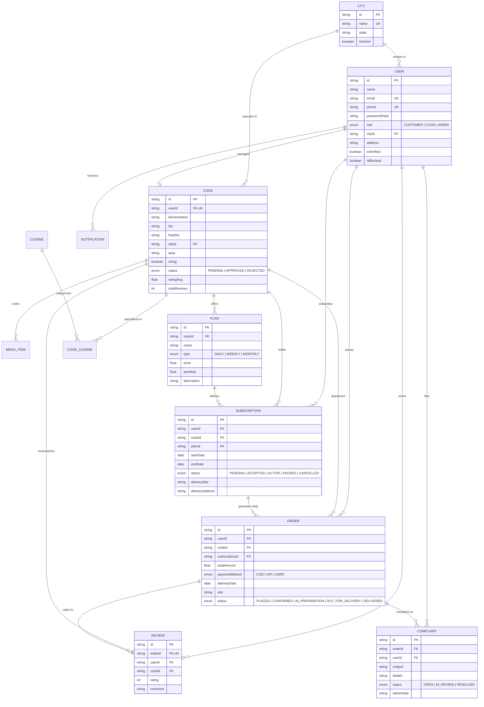

# HomeFeast — Entity Relationship Diagram (ERD) & Data Model

## 1. Mermaid Entity-Relationship Diagram

---

## 2. Relational Integrity & Key Indexes

To ensure lightning-fast multi-city queries and maintain sub-3-second page loads as user volume expands:

1. **`cooks (cityId, status)`**:
   - Compounded index used by `/search` and listing pages to retrieve only approved cooks within the selected city.
2. **`subscriptions (userId, status)`**:
   - Used by the Customer Dashboard to load current meal plans in < 5ms.
3. **`orders (cookId, deliveryDate)`**:
   - Used by the Cook Dashboard for today's kitchen packing and dispatch checklists.
4. **`notifications (userId, isRead)`**:
   - Used for the unread alert badge in navigation bars.
